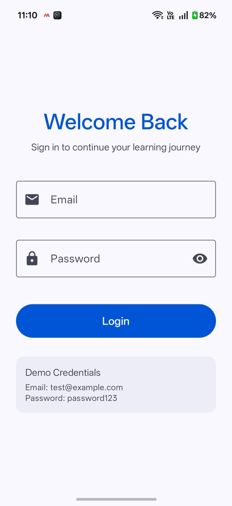
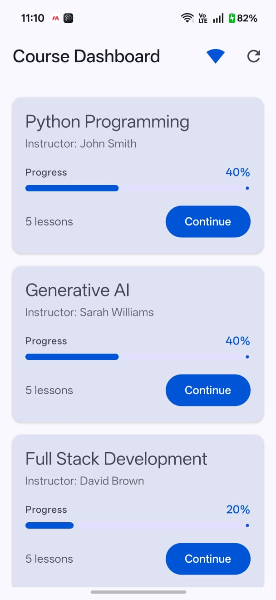
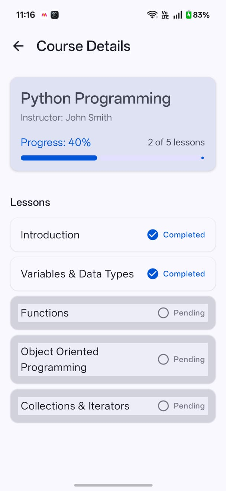
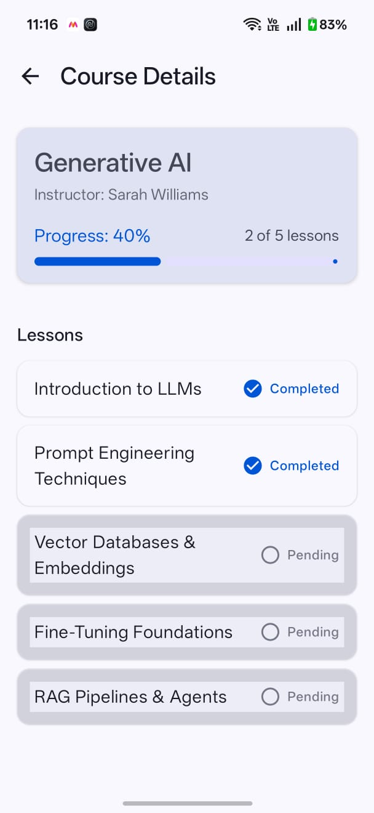

# Learning Dashboard Android Application

A production-quality Android application built with Jetpack Compose, Kotlin Coroutines & Flow, MVVM architecture, Room for offline persistence, Retrofit for networking abstraction, and Dagger Hilt for dependency injection.

---

## App Screenshots

| 1. Login Screen | 2. Course Dashboard | 3. Course Details (Python) | 4. Course Details (Gen AI) |
| :---: | :---: | :---: | :---: |
|  |  |  |  |

---


## 1. Architecture

The application adopts **MVVM (Model-View-ViewModel)** with the **Repository Pattern** and **Single Source of Truth (SSOT)**:

```text
UI (Jetpack Compose)
       ↓  (User Actions / Events)
   ViewModel (StateFlow & UiState)
       ↓
   Repository
   ├── RemoteDataSource (Retrofit / OkHttp)
   └── LocalDataSource (Room AppDatabase & DAOs)
```

### Why this architecture was selected:
* **Separation of Concerns**: UI components remain purely declarative without hosting business logic or performing side effects. ViewModels expose immutable `StateFlow<UiState>` collected lifecycle-safely via `collectAsStateWithLifecycle()`.
* **Repository as the Orchestrator**: Encapsulates data sourcing, caching policies, and data synchronization between remote endpoints and local persistence.
* **Testability & Maintainability**: Clean boundaries enable unit testing of domain calculations and ViewModels in complete isolation without Android framework dependencies.

---

## 2. Offline Support

The application is built offline-first using **Room** as the persistent local database:

```text
Remote API
    ↓ (Fetch data)
CourseRepository
    ↓ (Save / Sync preserving local status)
Room Cache (SQLite)
    ↓ (Reactive Flow)
UI (Compose)
```

### Offline Strategy:
1. **Network Available**:
   * Repository attempts remote sync via `RemoteDataSource`.
   * Fresh courses and lessons are synced into Room. Any user-modified lesson completion statuses are preserved.
   * Dynamic progress percentages are calculated using `ProgressCalculator.calculateProgress(completed, total)`.
2. **Network Unavailable / Network Error**:
   * If the network is unreachable (`IOException` / connection failure), the Repository seamlessly falls back to Room cache.
   * Debug message `Loaded courses from cache` is logged.
   * If local data exists, cached courses and lessons remain visible and interactive.
   * If Room is completely empty on the initial launch and network fails, an error state with a **Retry** action is presented.
3. **Offline Lesson Completion**:
   * When a user marks a lesson completed, the state is persisted directly in Room and dynamic course progress is recalculated atomically.
   * Closing or relaunching the application preserves completed lessons and calculated progress.

---

## 3. Security

* **No Credential Persistence**: Passwords are used strictly for in-flight authentication payload execution and are **never stored** in memory or on disk.
* **Production Token Storage**: In a production environment, authentication session tokens must **never** be stored in plain `SharedPreferences`. Instead, they should be stored using:
  * **Android Keystore-backed secure storage**: EncryptedSharedPreferences (Jetpack Security crypto) or raw Android Keystore with encrypted AES-GCM payloads.
  * Tokens should be automatically invalidated upon logout and scoped with BiometricPrompt / hardware-backed key attestation where high security is required.

---

## 4. Scale (1M+ Users & Hundreds of Courses)

To scale the platform to 1,000,000+ active users and hundreds of courses:

1. **Jetpack Paging 3 with Room RemoteMediator**:
   * Stream Paginated course catalogues in pages of 20–50 items from the backend directly into Room and Compose `LazyColumn`.
2. **CDN & HTTP Cache Validation (ETags / Cache-Control)**:
   * Serve course metadata and static assets via global CDNs (Cloudflare / CloudFront) using `If-None-Match` (304 Not Modified) to eliminate redundant payload transfers.
3. **Database Indexing & Query Optimization**:
   * Index foreign keys (`courseId` in lessons table) and title fields to keep SQLite query times sub-millisecond even with large datasets.
4. **Background Synchronization with WorkManager**:
   * Schedule periodic background syncs with battery and network constraints (`NetworkType.UNMETERED`) to keep course progress synced across devices.
5. **Observability & Crash Reporting**:
   * Implement OpenTelemetry / Firebase Crashlytics / Datadog for tracking ANRs, slow frame rates, network latency percentiles, and crash rates.

---

## 5. iOS / macOS Architecture Equivalence

The exact same architectural patterns translate 1-to-1 to Apple's modern Swift ecosystem:

| Android (Kotlin) | iOS / macOS (Swift) | Architectural Role |
| :--- | :--- | :--- |
| **Jetpack Compose** | **SwiftUI** | Declarative Reactive UI |
| **ViewModel (`StateFlow`)** | **`@Observable` / `@StateObject` (`@Published`)** | MVVM State Holder |
| **Kotlin Coroutines / Flow** | **Swift Concurrency (`async/await`, `AsyncSequence`)** | Asynchronous operations & streams |
| **Room (SQLite)** | **SwiftData / Core Data** | Persistent Local Database |
| **Retrofit + OkHttp** | **URLSession** | Network REST Client |
| **Dagger Hilt** | **Swift Dependencies / Factory / Swift DI** | Dependency Injection |
| **Android Keystore** | **Keychain Services** | Hardware-backed secure storage |

---

## 6. How to Build & Run

* **Build Debug APK**:
  ```bash
  ./gradlew assembleDebug
  ```
  Generated artifact: `app/build/outputs/apk/debug/app-debug.apk`

* **Run Unit Tests**:
  ```bash
  ./gradlew test
  ```

* **Demo Credentials**:
  * **Email**: `test@example.com`
  * **Password**: `password123`
